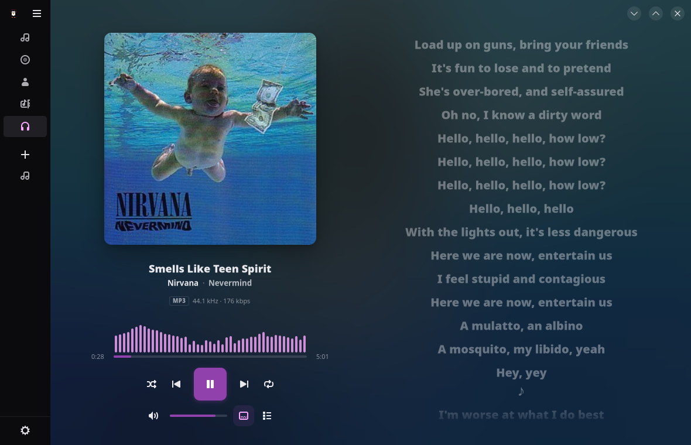
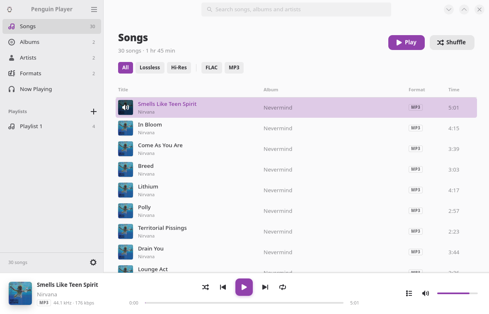
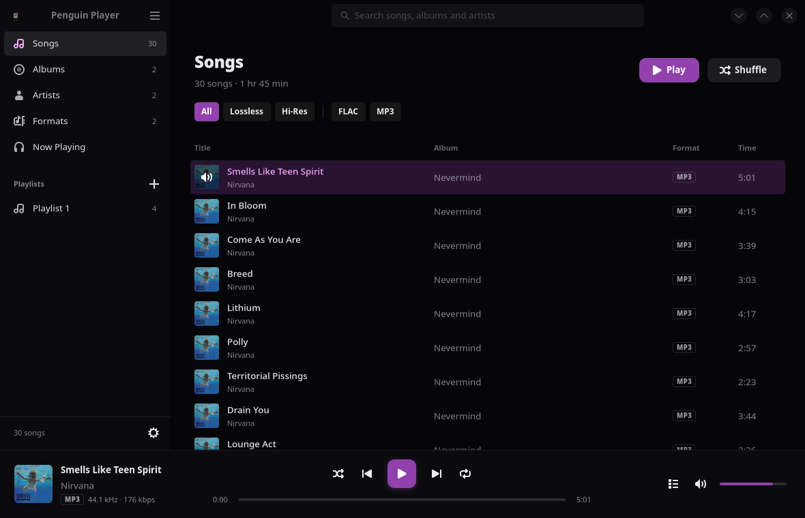
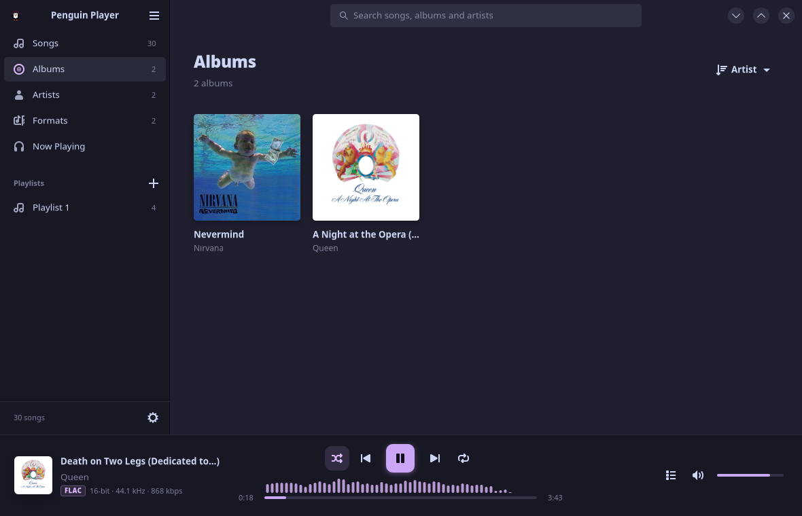
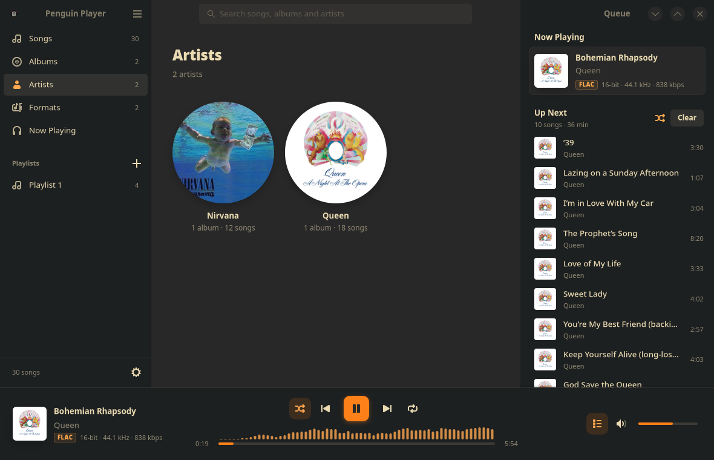
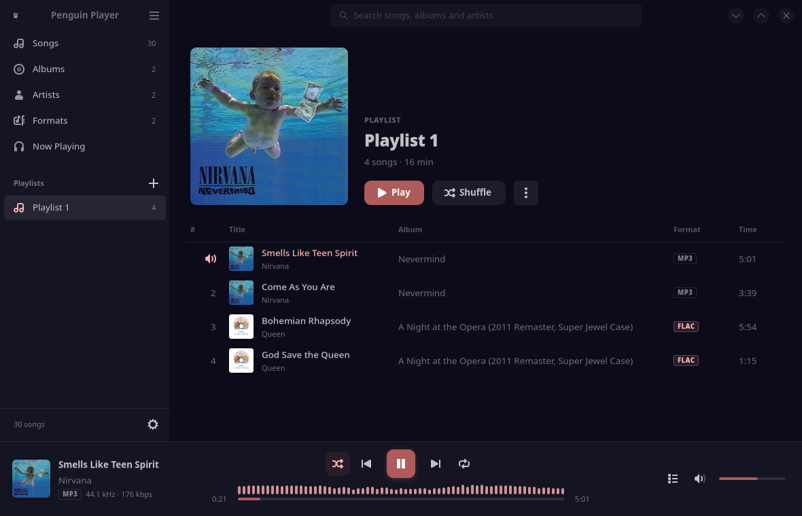
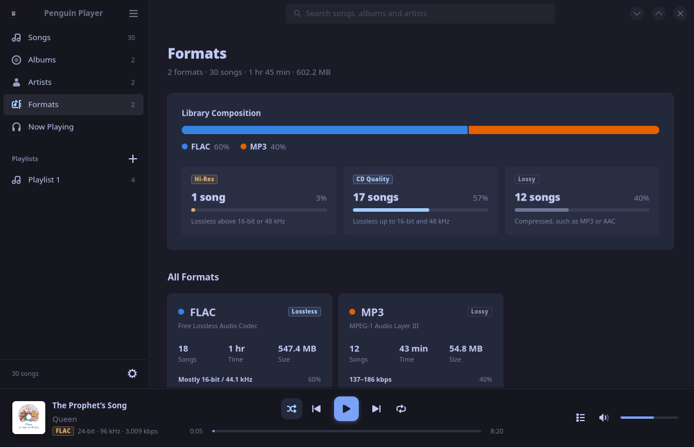
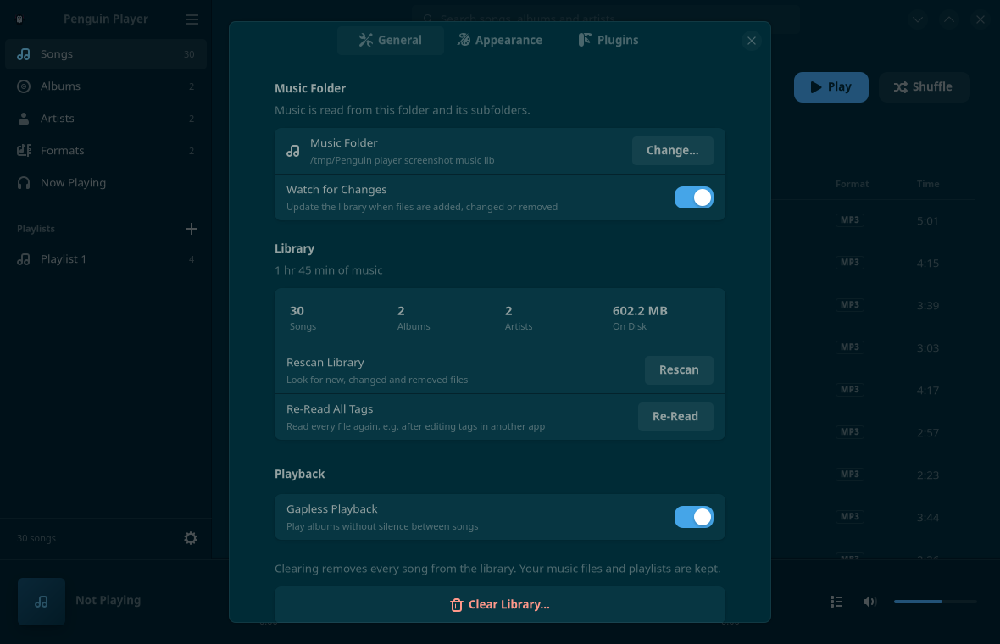
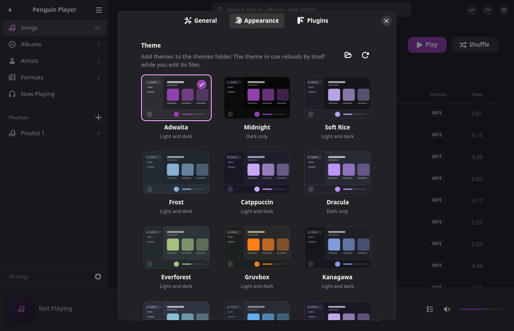
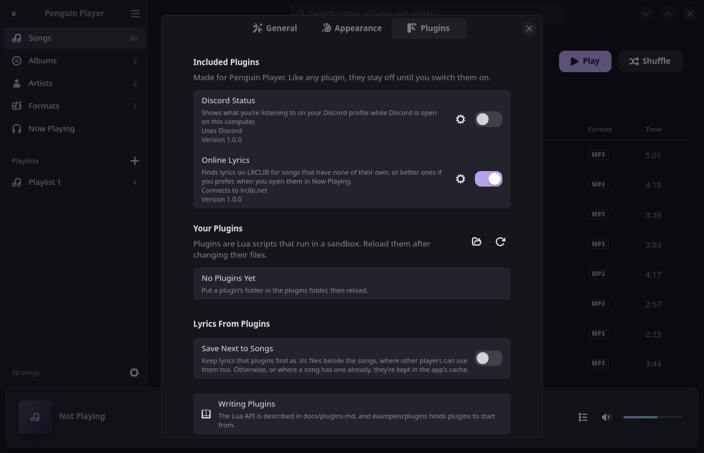

<div align="center">


# Penguin Player

**A clean, fast and beautiful offline music player, built for Linux.**

A native music player written in Rust, for playing your music files offline. It's for anyone who wants an aesthetically pleasing but functional music player.

[](https://github.com/01Cindyy/Penguin-player/releases/latest)
[](https://aur.archlinux.org/packages/penguin-player)
[](LICENSE)

</div>



## Features

- **Library and supported formats**: FLAC, ALAC, WAV, AIFF, MP3, AAC, Opus and Ogg Vorbis,
  scanned from a folder and kept up to date as it changes.
- **Browse and search**: songs, albums, artists and formats, with search as you type.
- **Playback**: gapless, in full quality, with shuffle, repeat and a queue you can
  reorder by dragging.
- **Now Playing**: the song fills the window over a blur of its art.
- **Lyrics**: timed lyrics from your files' tags or `.lrc` files follow the song.
- **Playlists** that keep track of songs whose files went missing.
- **Visualiser**: bars that move with the music, in your theme's colour.
- **Themes**: fourteen built in, plus your own and a Pywal theme that follows your
  wallpaper (see [pywal16](https://github.com/eylles/pywal16) for details); with extra
  options for corners, the visualiser and a translucent window.
- **Plugins** in Lua, sandboxed. Two come with the app: Online Lyrics, which finds lyrics
  on [LRCLIB](https://lrclib.net), and Discord Status, which shows what you're playing on
  your Discord profile.
- **Desktop integration on Linux**: media keys and the desktop's media controls (MPRIS).
- **Adaptive layout**, from wide windows down to phone-sized ones.

## Screenshots

| | |
|---|---|
| <br>Songs · Adwaita, light | <br>Songs · Midnight |
| <br>Albums · Catppuccin | <br>Artists and the queue · Gruvbox |
| <br>A playlist · Pywal | <br>Formats · Tokyo Night |

| | | |
|---|---|---|
| <br>Settings · Solarized | <br>Themes · Adwaita, dark | <br>Plugins · Soft Rice |

## Installing

Penguin Player needs **GTK 4.18** and **libadwaita 1.7** or newer, which come with
Debian 13, Ubuntu 25.04, Fedora 42, Arch Linux and anything newer. Downloads are on
the [releases page](https://github.com/01Cindyy/Penguin-player/releases/latest).

### Arch Linux (AUR)

```sh
Coming soon as AUR signups are currently closed. Please install manually for now.
yay -S penguin-player      # or paru, or any AUR helper
```

Or by hand:

```sh
git clone https://aur.archlinux.org/penguin-player.git
cd penguin-player
makepkg -si
```

### Debian and Ubuntu

Download the `.deb`, then:

```sh
sudo apt install ./penguin-player_1.0.0-1_amd64.deb
```

### Fedora

Download the `.rpm`, then:

```sh
sudo dnf install ./penguin-player-1.0.0-1.x86_64.rpm
```

### AppImage (any distribution)

Download the `.AppImage`, make it executable and run it:

```sh
chmod +x penguin-player-1.0.0-x86_64.AppImage
./penguin-player-1.0.0-x86_64.AppImage
```

The AppImage uses your system's GTK and libadwaita, so it needs the versions above.

### Other distributions

The `.tar.gz` holds the program and an installer. Extract it, then run, as yourself:

```sh
./install.sh          # for everyone, in /usr/local; asks for your password to copy
./install.sh --user   # just for you, in your home folder; no password needed
```

`./install.sh --uninstall` (with `--user` if you used it) removes it again.

### Checking your download

Each release has a `SHA256SUMS` file. With it in the same folder as your download:

```sh
sha256sum -c SHA256SUMS --ignore-missing
```

## Getting started

On first start, Penguin Player asks for your music folder. The first scan runs in the
background, so you can start listening straight away.

Your settings are in `~/.config/penguin-player/`, your library in
`~/.local/share/penguin-player/`, and cached covers and lyrics in
`~/.cache/penguin-player/`. Uninstalling the app leaves these in place, so for now
delete them yourself if you want them gone.

### Keyboard shortcuts

| Keys | Action |
|---|---|
| Space | Play or pause |
| Ctrl+→ / Ctrl+← | Next / previous song |
| Ctrl+↑ / Ctrl+↓ | Volume up / down |
| Ctrl+S | Shuffle on or off |
| Ctrl+R | Repeat: off, all, one |
| Ctrl+F, or just start typing | Search |
| Ctrl+L | Show or hide the queue |
| Esc or Alt+← | Back |
| Ctrl+, | Preferences |
| Ctrl+Q | Quit |

## Themes and plugins

- [docs/themes.md](docs/themes.md): make a theme, from one accent colour to a full
  restyle with CSS. [examples/themes](examples/themes) has a complete example.
- [docs/plugins.md](docs/plugins.md): write a Lua plugin, with the full API reference.
  [examples/plugins](examples/plugins) has a few to start from.

## Privacy

Penguin Player doesn't go online. The only exceptions are plugins you switch on
yourself, and only to the sites they ask for and you allow. With Online Lyrics, the
title and artist of a song are sent to LRCLIB when you open its lyrics; with Discord
Status, what you're playing goes to the Discord app on your computer.

## Building from source

You need Rust 1.92 or newer, GTK 4.18 and libadwaita 1.7 with their development
files, ALSA and D-Bus development files, a C compiler, CMake and pkg-config.

```sh
# Arch Linux
sudo pacman -S --needed base-devel cmake rust gtk4 libadwaita alsa-lib dbus
# Debian 13, Ubuntu 25.04 or newer (and Rust from rustup.rs)
sudo apt install build-essential cmake pkg-config libgtk-4-dev libadwaita-1-dev libasound2-dev libdbus-1-dev
# Fedora 42 or newer
sudo dnf install gcc cmake pkgconf-pkg-config gtk4-devel libadwaita-devel alsa-lib-devel dbus-devel rust cargo
```

Then:

```sh
cargo run --release   # build and run
./install.sh          # build and install as a desktop app (see ./install.sh --help)
```

[docs/ARCHITECTURE.md](docs/ARCHITECTURE.md) explains how it fits together, and
[packaging/README.md](packaging/README.md) how the release packages are made.

## Feedback

Found a bug or have an idea? [Open an issue](https://github.com/01Cindyy/Penguin-player/issues).
Contributions are welcome too.

## Licence

Penguin Player is licensed under the [MIT licence](LICENSE). The open source software
it's built with, and their licences, are listed in
[THIRD-PARTY-LICENSES.txt](THIRD-PARTY-LICENSES.txt). Its icons, apart from the
penguin, come from the [Adwaita icon theme](https://gitlab.gnome.org/GNOME/adwaita-icon-theme)
by the GNOME Project.

Made with [GTK](https://gtk.org), [libadwaita](https://gnome.pages.gitlab.gnome.org/libadwaita/),
[Symphonia](https://github.com/pdeljanov/Symphonia) and [gtk-rs](https://gtk-rs.org).
